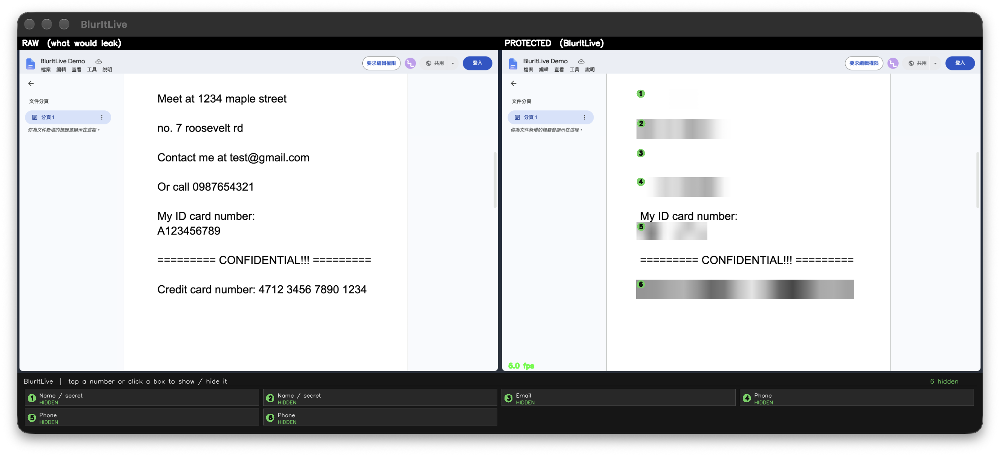

# BlurItLive

**Real-time, on-device privacy net for live video.** It reads your outgoing
frame, finds anything private the instant it appears — a notification popup, a
browser autocomplete dropdown, a leaked message, a bystander's face — and covers
it before it ever leaves your machine.

Built for the **ASUS UGen AI League 2026** (Creator AI theme, Battlefield
Lightning / UGen300 track). This repo is the **Stage I proof of concept**: it
proves the *capture → detect → mask → display* loop on a laptop. Stage II moves
the detectors onto the UGen300 NPU so the work never touches the GPU your game
needs.

**Demo video:** https://youtu.be/RlCiOQukYGY  
**Proposal deck:** see the PDF submitted to the league.



---

## What it does today

- **Captures a feed:** a monitor, your webcam, or a recorded clip.
- **Faces** are detected (OpenCV Haar, front + profile) and blurred — for the
  bystander-on-camera case, and for faces inside shared images.
- **Private text** is read by a deep-learning OCR model (EasyOCR) and classified
  by `rules.py`: emails, phone numbers, credit cards, IPs, Taiwan IDs, addresses
  (English and Chinese), plus any scripted demo strings — blurred **wherever on
  screen they appear**, whole line at a time.
- **You hold the switches, per box.** Every covered region gets a numbered badge
  and its own entry in the control bar. Press its number — or click the box — to
  reveal or re-cover **that one element**, not the whole category. Green = hidden,
  orange = shown.
- **Smooth, not flickery.** Faces *and* text use a short persistence buffer, so a
  single missed detection never uncovers a region for a frame.
- **Off the main thread.** OCR runs on a background thread, so heavy inference
  never stalls the display / face loop.
- A **RAW vs PROTECTED** split view makes the demo self-explanatory.

The point it demonstrates: detection is **content-based and source-agnostic** —
it does not matter which app the text or face came from, only that it is on the
outgoing frame.

## Setup

```bash
python -m venv .venv
source .venv/bin/activate          # Windows: .venv\Scripts\activate
pip install -r requirements.txt
```

First run downloads the EasyOCR model automatically. To skip the text model for
now, run face-only with `--no-ocr`.

## Run

```bash
cd src
python main.py --source screen --compare                 # live screen, split view
python main.py --source screen --compare --fast          # smooth on a CPU-only Mac
python main.py --source screen --compare --lang ch_tra en  # read Chinese too
python main.py --source webcam                           # bystander-face demo
python main.py --source file --path ../demo.mp4 --compare
```

**Keys:** `q` quit · `s` save a screenshot to `../captures/` · `1`–`9` show/hide the
box with that number · or **left-click any box** to show/hide just that one.

**Useful flags:**

| Flag | What it does |
| --- | --- |
| `--compare` | side-by-side RAW vs PROTECTED |
| `--fast` | smooth-demo mode on a CPU-only machine (frontal-only faces, lighter detect, smaller frame) |
| `--lang ch_tra en` | OCR languages (default `en`); add `ch_tra` for Traditional Chinese |
| `--monitor 2` | capture a second display (dual-monitor recording) |
| `--style pixelate` / `box` | mosaic or solid cover instead of blur |
| `--face-neighbors 3` | more sensitive face detection (groups / small faces) |
| `--face-min-size 30` | smallest face to catch, in px |
| `--text-miss-passes` | uncover text only after it is missing from N OCR passes in a row (default 2) |
| `--no-gpu` | force EasyOCR onto CPU |
| `--no-ocr` | faces only, skip the text model |

## How to record the demo

1. Put a few **fake** secrets into `DEMO_SECRETS` in `src/rules.py` (names and
   addresses have no fixed format, so they must be listed; emails / phones /
   cards / IDs are caught automatically by their format).
2. Run `python main.py --source screen --compare`.
3. On screen, bring each leak into frame on cue (a notes doc with addresses, an
   email, a phone number, an ID and a card, plus an image with a face). The
   PROTECTED panel covers each one while RAW shows what a viewer would otherwise
   have seen.
4. Click one covered box (or press its number) to reveal just that item, then
   click again to re-cover it — the "you decide what's private" moment.

## How this maps to the proposal

| Pipeline stage | Stage I (this repo) | Stage II (on UGen300) |
| --- | --- | --- |
| Capture | mss / OpenCV on laptop | OBS source tap |
| Detect | OpenCV faces + EasyOCR + rules | models ported to the NPU |
| Decide "is this private" | `rules.py` patterns + keywords | learned context classifier |
| Mask + show | size-scaled blur, split view | re-inject before the encoder |
| Where it runs | laptop CPU | **dedicated NPU, GPU untouched** |

The interface in `detectors/base.py` is deliberately tiny, so the Stage II
upgrade is a drop-in swap of the detector, not a rewrite.

## Structure

```
src/
  main.py                     entry point / render loop, toggles, persistence
  capture.py                  screen / webcam / file sources
  redactor.py                 blur / pixelate / box the detected regions
  rules.py                    what counts as private (Stage I stand-in)
  detectors/
    base.py                   Detection + Detector interface
    face_detector.py          OpenCV Haar face detection
    text_pii_detector.py      EasyOCR + line grouping + rules
```

## Honest limits (Stage I)

- Detection is pattern + keyword rules, **not yet a learned classifier** — so
  free-form private text (e.g. "See the dentist") is not caught. That semantic
  step is the first Stage II goal.
- Face detection is classic Haar: reliable on frontal faces, weaker on steep
  angles, small faces, or crowded group photos. Stage II swaps in a CNN detector.
- Chinese OCR works (`--lang ch_tra`) but is slower and less consistent on a
  CPU; the NPU is what makes it real-time.
- Not yet on the UGen300. Measuring GPU-free operation on the NPU is the first
  Stage II deliverable.

## License

MIT. See `LICENSE`.
